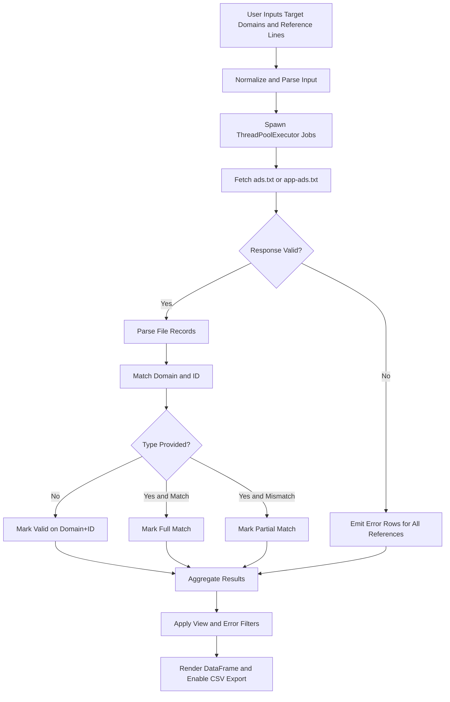

# Ads.txt / App-ads.txt Line Checker

Validate `ads.txt` and `app-ads.txt` partner declarations at scale with a Streamlit-powered, multi-threaded auditing workflow for AdOps, monetization, and supply-path verification.

[](LICENSE)


> [!IMPORTANT]
> This project is currently implemented as a Streamlit application (not a packaged Python library), with reusable validation logic embedded in `app.py`.

## Table of Contents

- [Features](#features)
- [Tech Stack & Architecture](#tech-stack--architecture)
  - [Core Stack](#core-stack)
  - [Project Structure](#project-structure)
  - [Key Design Decisions](#key-design-decisions)
- [Getting Started](#getting-started)
  - [Prerequisites](#prerequisites)
  - [Installation](#installation)
- [Testing](#testing)
- [Deployment](#deployment)
- [Usage](#usage)
- [Configuration](#configuration)
- [License](#license)
- [Contacts & Community Support](#contacts--community-support)

## Features

- Bulk domain validation using `ThreadPoolExecutor` for concurrent fetch and comparison workflows.
- Dual-target mode for both:
  - `ads.txt` (web inventory)
  - `app-ads.txt` (in-app inventory)
- Resilient URL normalization that accepts raw hostnames and protocol-prefixed inputs.
- Multi-protocol retrieval strategy (`https` first, then `http`) with redirect handling.
- SSL fallback mode (`verify=False` retry path) for non-compliant publisher endpoints.
- Soft-404 detection by identifying HTML payloads served at text-file endpoints.
- Rule-based matching engine supporting:
  - Domain + Publisher ID matching
  - Optional Account Type (`DIRECT` / `RESELLER`) enforcement
  - Partial match diagnostics for type mismatch scenarios
- Result quality triaging with dedicated statuses (`Valid`, `Partially matched`, `Not found`, `Error`, `System Error`).
- Analyst-friendly filtering for error-only workflows and category-based triage.
- Two report layouts:
  - Standard vertical table (row per reference check)
  - Horizontal aggregated matrix (domain-centric review)
- CSV export (`UTF-8 BOM`) for spreadsheet compatibility and downstream ops reporting.
- Session-persistent results and input ordering via Streamlit `session_state`.
- Dark-theme UI with custom styling and color-coded status semantics.

> [!TIP]
> Use **Errors / Warnings Only** mode with selective filters to reduce noise when auditing large publisher batches.

## Tech Stack & Architecture

### Core Stack

- **Language:** Python 3.8+
- **UI Runtime:** Streamlit
- **Data Processing:** pandas
- **HTTP Client:** requests
- **Concurrency:** `concurrent.futures.ThreadPoolExecutor`
- **Parsing Utilities:** `urllib.parse`
- **Static Assets:** PNG icon under `icons/`

### Project Structure

```text
.
├── app.py                # Streamlit UI + validation core logic
├── requirements.txt      # Runtime dependencies
├── LICENSE               # GNU AGPL v3 license
├── README.md             # Project documentation
└── icons/
    └── icon.png          # Application favicon/logo
```

### Key Design Decisions

1. **UI-first architecture**
   - The app is intentionally single-file (`app.py`) to simplify distribution and onboarding.
   - Business logic and presentation are colocated for rapid iteration in Streamlit environments.

2. **Network fault tolerance over strict purity**
   - The fetch layer retries over protocol variants and includes SSL bypass fallback to maximize recoverability against real-world publisher misconfiguration.

3. **Deterministic output ordering**
   - Results are post-sorted using the original target input sequence for analyst predictability.

4. **Operationally pragmatic matching model**
   - A reference line is treated as valid with domain+ID, while account type remains optional and upgraded to strict validation when provided.

5. **Built-in anti-noise controls**
   - Error classification and view filtering are first-class to support high-volume incident triage.



> [!NOTE]
> Thread pool concurrency is currently capped in code (`MAX_WORKERS = 5`) to balance throughput and endpoint friendliness.

## Getting Started

### Prerequisites

- Python `3.8+`
- `pip` (or `pip3`)
- Network access to target publisher domains

Optional but recommended:
- Virtual environment (`venv`, `virtualenv`, or `conda`)

### Installation

1. Clone the repository.

```bash
git clone https://github.com/<your-org-or-user>/Ads.txt-App-ads.txt-line-Checker.git
cd Ads.txt-App-ads.txt-line-Checker
```

2. Create and activate a virtual environment.

```bash
python -m venv .venv
source .venv/bin/activate
```

3. Install dependencies.

```bash
pip install --upgrade pip
pip install -r requirements.txt
```

4. Start the Streamlit application.

```bash
streamlit run app.py
```

5. Open the local endpoint displayed by Streamlit (typically `http://localhost:8501`).

> [!WARNING]
> If your environment intercepts SSL traffic, some remote validations may return false negatives or SSL-related errors.

## Testing

This repository does not currently ship a formal `tests/` suite. For functional validation, use a layered check strategy:

1. **Dependency sanity check**

```bash
python -m pip check
```

2. **Static syntax validation**

```bash
python -m py_compile app.py
```

3. **Runtime smoke test**

```bash
streamlit run app.py
```

4. **Manual scenario checks in UI**
   - Empty inputs trigger warning.
   - Invalid reference format is ignored.
   - Domain returning HTML at `/ads.txt` is flagged as error.
   - Mismatch between expected and observed account type appears as partial match.

> [!CAUTION]
> Because endpoint availability is external and time-dependent, deterministic integration tests require controlled fixtures or mocked HTTP responses.

## Deployment

### Production Deployment Guidelines

- Run behind a process manager and reverse proxy for resilience.
- Use `https` termination at the proxy layer.
- Restrict egress where required by policy while preserving target domain access.

### Minimal Build/Run Pattern

```bash
pip install -r requirements.txt
streamlit run app.py --server.port 8501 --server.address 0.0.0.0
```

### Containerization (Example)

> [!NOTE]
> No Docker assets are currently committed; the snippet below is a recommended baseline.

```dockerfile
FROM python:3.11-slim
WORKDIR /app
COPY requirements.txt .
RUN pip install --no-cache-dir -r requirements.txt
COPY . .
EXPOSE 8501
CMD ["streamlit", "run", "app.py", "--server.port=8501", "--server.address=0.0.0.0"]
```

### CI/CD Integration Recommendations

- Add a pipeline stage for:
  - dependency install
  - `py_compile` validation
  - optional linting (`ruff`/`flake8`)
- Gate merges on successful smoke checks.
- Publish container artifacts for immutable deployments.

## Usage

### 1) Launch the application

```bash
streamlit run app.py  # starts the interactive validator UI
```

### 2) Provide targets and references

```txt
# Target Websites (one host per line)
example.com
news-site.org
app.publisher.net
```

```txt
# Reference Lines: domain, publisher_id, account_type(optional)
google.com, pub-1234567890, DIRECT
appnexus.com, 1234, RESELLER
rubiconproject.com, 5678
```

### 3) Run validation and export

```text
1. Choose file mode (ads.txt or app-ads.txt).
2. Choose output scope (all results or errors only).
3. Click "Start Validation".
4. Review table output and download CSV report.
```

### Result Semantics

- `Valid`: expected mapping was found.
- `Partially matched`: domain+ID found, but account type mismatch.
- `Not found`: no domain+ID pair matched.
- `Error` / `System Error`: fetch or runtime issue.

> [!TIP]
> Use horizontal mode for executive summary reporting, and vertical mode for deep per-line diagnostics.

## Configuration

This project is primarily configured through runtime UI choices and a few hard-coded execution defaults.

### Runtime Options in UI

- **File Type:** `ads.txt` or `app-ads.txt`
- **Output View:** full output or warning/error-only output
- **Layout:** vertical or horizontal aggregated
- **Error Filters:** category-level toggles when warning/error-only mode is enabled

### Hard-Coded Operational Parameters (`app.py`)

- `MAX_WORKERS = 5`
  - Controls concurrent domain processing.
- `timeout=15`
  - HTTP request timeout in seconds.
- `time.sleep(random.uniform(0.5, 1.5))`
  - Per-request jitter to reduce burst pressure.
- `LIVE_UA = "Mozilla/5.0 ..."`
  - User-Agent used for remote fetch requests.

### Environment Variables

- No mandatory environment variables are currently required.
- If you deploy with Streamlit server flags, manage host/port via CLI args or Streamlit config.

### Streamlit Server Flags (Example)

```bash
streamlit run app.py --server.port 8501 --server.address 0.0.0.0
```

> [!IMPORTANT]
> For enterprise deployment, externalize concurrency and timeout parameters to environment variables to improve operational control.

## License

This project is licensed under the **GNU Affero General Public License v3.0 (AGPL-3.0)**. See [LICENSE](LICENSE) for full terms.

## Contacts & Community Support

## Support the Project

[](https://www.patreon.com/OstinFCT)
[](https://ko-fi.com/fctostin)
[](https://boosty.to/ostinfct)
[](https://www.youtube.com/@FCT-Ostin)
[](https://t.me/FCTostin)

If you find this tool useful, consider leaving a star on GitHub or supporting the author directly.
